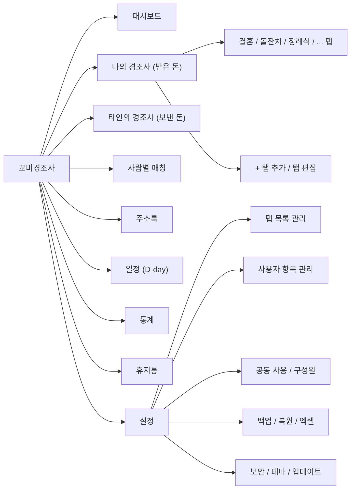
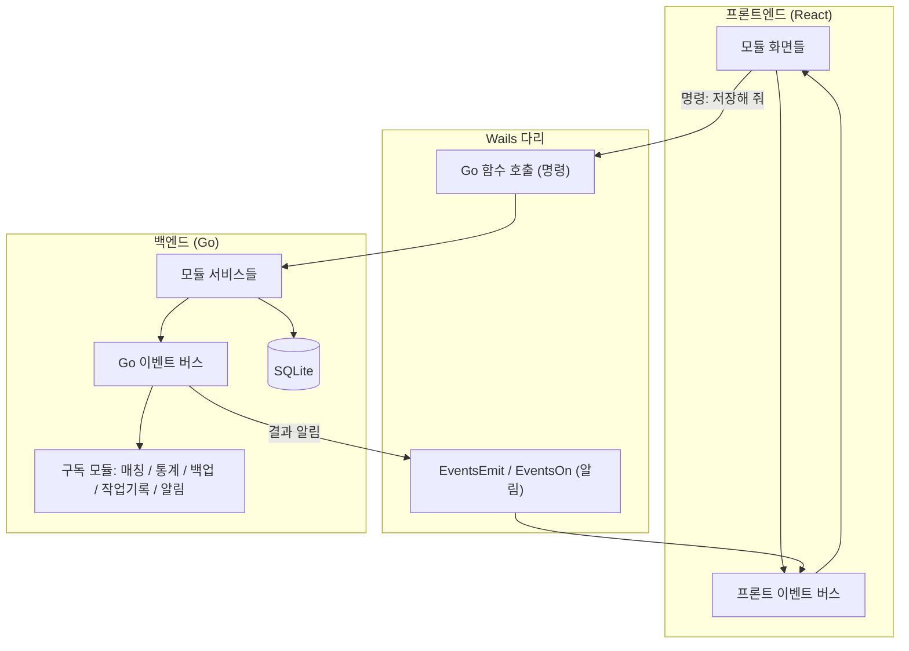

# 꼬미경조사 기획안 (v0.2)

> 윈도우용 단독 실행 프로그램 `꼬미경조사.exe`
> 경조사비 **받은 내역(내 경조사)** 과 **보낸 내역(타인 경조사)** 을 정리하고, 사람별로 주고받은 기록을 맞춰 보여줍니다.

## 0. 이번에 바뀐 점 (v0.1 → v0.2)
- ✅ **메뉴·기능별 모듈 구조 + 이벤트 기반 구조** 적용 (3장)
- ✅ **Windows 자격 증명 자동 로그인 확인 완료**: 이 PC에 `purnpadosori` 계정이 이미 저장되어 있어 토큰을 따로 입력하지 않아도 됩니다 (8장)
- ✅ **경조사 탭 목록** 추가·이름 변경·순서 변경·숨기기·삭제 가능 (4-1)
- ✅ **추가 제안 기능 전부 반영** (5장)
- ✅ **공동 사용 모드** 추가. 켤지 말지는 사용자가 설정에서 선택 (6장)

---

## 1. 기술 스택

| 구분 | 사용 기술 | 이유 |
|---|---|---|
| 데스크톱 틀 | **Wails v2** (설치 확인: v2.15.0) | Go와 React를 exe 파일 하나로 묶음 |
| 백엔드 | **Go** (설치 확인: 1.27) | 요청과 같음 |
| 프론트엔드 | **Vite + React (JavaScript)**, HTML5 | 요청과 같음 (Node v24 설치 확인) |
| UI 부품 | **Radix UI Primitives** | 탭, 팝업, 메뉴, 알림창, 드롭다운 |
| 스타일 | **순수 CSS** (CSS 변수 디자인 시스템) | 라이트/다크 테마 |
| 그래프 | **HTML5 Canvas** 직접 그리기 | 통계 차트 |
| DB | **SQLite (modernc.org/sqlite, 순수 Go)** | C 컴파일러 없이 어느 PC에서나 빌드 가능 |
| 엑셀 | **excelize** | 가져오기/내보내기 |
| PDF/인쇄 | 웹뷰 인쇄 기능 + 인쇄용 CSS | 방명록 형태 출력 |

### 실행 안전장치
- DB·백업·로고 위치는 `os.Executable()`로 **exe가 있는 폴더 기준**으로 찾음 (바로가기로 실행해도 안전)
- 한글·띄어쓰기 경로(예: `D:\kkomi events`) 안전 처리 (`filepath.Join`)
- 처음 실행하면 빈 DB `data/kkomi.db` 자동 생성
- `.gitignore`: `*.db`, `*.sqlite`, `data/`, `backup/`, `build/bin/` → 이름·전화번호 등 개인정보 유출 차단

---

## 2. 메뉴 구성



---

## 3. 구조: 모듈화 + 이벤트 기반 ⭐

### 3-1. 기본 원칙
1. **메뉴·기능 하나 = 모듈 하나.** 모듈은 자기 폴더 안에 화면, 로직, 데이터 처리를 모두 갖습니다.
2. **모듈끼리 직접 부르지 않고 이벤트로만 연락합니다.** 예: "받은 내역이 추가됨"이라는 이벤트를 보내면, 관심 있는 모듈(매칭, 대시보드, 백업 등)이 각자 알아서 반응합니다.
3. 그래서 **기능을 추가하거나 빼도 다른 모듈을 고칠 필요가 없습니다.** 새 모듈은 등록만 하면 메뉴에 나타납니다.

### 3-2. 전체 흐름



- **명령(Command)**: 화면 → Go 함수 호출 (예: `Received.Create(...)`)
- **이벤트(Event)**: Go가 처리 후 `received.created` 발행 → Go 안의 다른 모듈 + 화면 모두에 전달
- 화면은 이벤트를 받으면 **자동으로 새로고침** (예: 받은 내역을 넣으면 대시보드 숫자가 즉시 바뀜)

### 3-3. 주요 이벤트 목록

| 이벤트 이름 | 발행 모듈 | 반응하는 모듈 |
|---|---|---|
| `eventtype.created/updated/deleted/reordered` | 탭 관리 | 나의 경조사(탭 다시 그림), 타인 경조사(종류 목록), 통계 |
| `myevent.created/updated/deleted` | 나의 경조사 | 대시보드, 일정, 통계 |
| `received.created/updated/deleted` | 나의 경조사 | 매칭, 주소록, 대시보드, 통계, 작업기록 |
| `sent.created/updated/deleted` | 타인 경조사 | 매칭, 주소록, 대시보드, 일정, 통계 |
| `person.merged/updated` | 주소록 | 매칭, 나의/타인 경조사 |
| `customfield.changed` | 사용자 항목 | 해당 메뉴 표 다시 그림 |
| `member.changed` / `mode.changed` | 공동 사용 | 모든 목록(구성원 필터) |
| `trash.restored/purged` | 휴지통 | 관련 메뉴 전체 |
| `backup.done/failed`, `import.done` | 백업·엑셀 | 알림창(Toast) |
| `app.locked/unlocked` | 보안 | 전체 화면 |

### 3-4. 모듈 목록

| 모듈 | 백엔드 (Go) | 프론트엔드 (React) |
|---|---|---|
| core | 이벤트 버스, 경로, DB 연결, DB 버전 관리(마이그레이션), 모듈 등록 | 이벤트 버스, 메뉴 등록, 레이아웃, 공통 부품 |
| eventtype | 탭(경조사 종류) 관리 | 탭 편집 화면 |
| myevent | 나의 경조사 행사 + 받은 내역 | 탭 화면, 받은 내역 표 |
| sent | 타인 경조사 보낸 내역 | 보낸 내역 표 |
| person | 주소록, 전화번호 정리, 동명이인·병합 | 주소록 화면 |
| matching | 사람별 주고받은 계산 | 매칭 화면, 입력 시 참고 금액 알림 |
| customfield | 사용자 추가 항목 | 항목 관리 화면, 표에 자동 반영 |
| member | 공동 사용, 구성원 | 구성원 관리, 상단 구성원 선택 |
| dashboard | 요약 계산 | 대시보드 |
| schedule | 다가오는 일정 | 일정(D-day) 화면 |
| stats | 통계 계산 | Canvas 차트 |
| trash | 휴지통 | 휴지통 화면 |
| backup | 자동 백업/복원 | 백업 화면 |
| excel | 가져오기/내보내기 | 가져오기 마법사 |
| print | 인쇄용 데이터 | 인쇄 미리보기 |
| security | 비밀번호 잠금 | 잠금 화면 |
| settings | 설정 저장 | 설정 화면, 테마 |
| updater | Gitea 릴리즈 확인 | 업데이트 안내 |
| auditlog | 작업 기록(누가 언제 무엇을) | 기록 보기 |

---

## 4. 핵심 기능

### 4-1. 나의 경조사 + 탭 관리 (요청 1, 3, 질문 2)
- 기본 탭: 결혼 / 돌잔치 / 장례식 / 회갑·칠순 / 집들이 / 개업 / 기타
- **탭 편집 가능** ✅
  - 탭 **추가**, **이름 바꾸기**, **아이콘·색 지정**
  - **순서 변경** (끌어서 놓기)
  - **숨기기** (기록은 남기고 탭만 감춤)
  - **삭제**: 기록이 있는 탭은 "다른 탭으로 옮길까요?"를 먼저 묻고, 삭제한 탭은 휴지통으로 이동
  - 탭 바로 옆 **"+" 버튼** 또는 **설정 → 탭 목록 관리**에서 편집
- 한 탭에 행사 여러 개 가능 (예: 장례식 탭 → 2020 조부상, 2026 부친상)
- 행사 정보: 행사명, 날짜, 장소, 주인공(본인/자녀/부모 등), 담당 구성원(공동 사용 시), 비고
- 받은 내역 표:

| 날짜 | 입금자명 | 전화번호 | 관계 | 금액 | 받은 방법 (현금/계좌/화환/선물) | 답례 | 비고 | 사용자 항목… |
|---|---|---|---|---|---|---|---|---|

- 합계 금액·인원수 자동 표시, 검색·정렬

### 4-2. 타인의 경조사 (요청 2, 4)

| 날짜 | 이름 | 전화번호 | 관계 | 경조사 종류 | 금액 | 보낸 방법 | 참석 | 비고 | 사용자 항목… |
|---|---|---|---|---|---|---|---|---|---|

- 경조사 종류는 **탭 목록과 공유** (탭을 추가하면 여기도 바로 반영 → 이벤트로 처리)
- 미래 날짜로 넣으면 **일정(D-day)** 에 자동 등록
- 기간·종류·관계·구성원 필터

### 4-3. 사람별 매칭 (요청 5)
- **이름 + 전화번호**로 같은 사람을 묶음 (`010-1234-5678` = `01012345678`)
- 이름은 같은데 전화번호가 없으면 "같은 사람인가요?" 확인
- 사람을 누르면 주고받은 기록을 **시간순으로** 보여줌
- 상태: 🟡 갚을 차례 / 🔵 받을 차례 / 🟢 균형
- 필터: "내 경조사에 왔는데 나는 아직 안 간 사람"
- 타인 경조사 입력 중 이름을 치면 **"홍길동 님은 2025년 내 결혼식에 10만원을 내셨습니다"** 라고 바로 알려줌

### 4-4. 비고 + 사용자 항목 추가 (요청 6)
- 모든 표에 비고 칸 기본 제공
- 메뉴·탭마다 **"+ 항목 추가"**: 글자 / 숫자 / 금액 / 날짜 / 체크 / 선택목록
- 항목 이름 변경, 순서 변경, 숨기기, 삭제
- 항목을 늘려도 DB 구조는 바꾸지 않음 (항목 정의 표 + 값 표)

---

## 5. 추가 기능 (전부 반영)

| 기능 | 설명 |
|---|---|
| **대시보드** | 올해 받은 돈/보낸 돈, 차액, 최근 기록, "갚을 차례" 인원, 다가오는 일정 |
| **엑셀 가져오기/내보내기** | 기존 엑셀 장부 불러오기 (칸 연결 마법사 + 미리보기), 메뉴별·전체 내보내기 |
| **자동 백업/복원** | 종료할 때와 하루 한 번 `backup/`에 자동 저장 (최근 30개 보관), 수동 백업, 다른 위치로 백업 |
| **휴지통** | 지운 기록 되살리기, 30일 뒤 자동 비우기 (기간은 설정 가능) |
| **주소록** | 사람 정보·관계·메모, 이름 오타 병합, 그룹(친척/직장/친구 등) |
| **통계 (Canvas)** | 연·월별 수입/지출 막대그래프, 종류별 원형그래프, 관계별 평균 금액, 구성원별 비교 |
| **일정 (D-day)** | 다가오는 타인 경조사 목록, 대시보드 표시, 실행할 때 오늘·내일 일정 알림 |
| **답례 체크** | 감사 문자·답례품 보냈는지 체크, 답례 안 한 사람 목록 |
| **인쇄/PDF** | 행사별 방명록, 사람별 내역, 기간별 장부 출력 |
| **비밀번호 잠금** | 실행할 때 PIN 입력, 일정 시간 사용하지 않으면 자동 잠금 (선택) |
| **라이트/다크 모드** | 테마 전환, 글자 크기 조절 |
| **금액 빠른 입력** | 3만/5만/10만 버튼, "5" 입력 → 50,000원, 한글 금액 표시 (오만원) |
| **업데이트 확인** | Gitea 릴리즈 확인 → 새 버전 다운로드 → 교체 (릴리즈는 요청할 때만 만듦) |
| **작업 기록** | 누가 언제 무엇을 추가·수정·삭제했는지 기록 (공동 사용 때 특히 유용) |
| **실행 취소** | 방금 한 저장·삭제를 되돌리기 (Ctrl+Z) |

---

## 6. 공동 사용 모드 (사용자가 선택)

설정 → **사용 방식**에서 선택:

| 방식 | 설명 |
|---|---|
| **혼자 사용** (기본) | 구성원 구분 없이 단순하게 사용 |
| **함께 사용** | 배우자·가족 등 **구성원**을 등록하고, 기록마다 "누구 쪽" 손님인지 구분 |

**함께 사용을 켜면**
- 구성원 등록: 이름, 색깔, (선택) 개인 PIN
- 기록마다 **"누구측"** 칸 추가 (예: 신랑측/신부측, 본인/배우자/공동)
- 화면 위쪽에 **구성원 선택**: 전체 보기 / 나만 보기 / 배우자만 보기
- 통계·매칭을 구성원별로 따로 보거나 합쳐서 보기
- 작업 기록에 "누가 입력했는지" 남김
- 언제든 다시 "혼자 사용"으로 바꿀 수 있음 (데이터는 그대로 유지)

**여러 PC에서 함께 쓰는 방법** (설정에서 선택)
1. **한 PC에서 같이 사용** (추천, 가장 안전)
2. **DB 위치를 공유 폴더로 지정** (NAS, OneDrive 등)
   - 동시에 고치면 충돌할 수 있어 **"사용 중" 잠금 파일**로 한 번에 한 명만 수정
   - 다른 사람이 쓰는 중이면 "읽기 전용으로 열기"를 안내
3. **엑셀/백업 파일로 주고받기**: 내보낸 파일을 상대방 PC에서 가져오기 (중복은 자동으로 건너뜀)

> [!NOTE]
> 실시간 동시 편집(서버 방식)은 단독 실행 프로그램 범위를 넘어서서 제외했습니다. 필요하면 나중에 추가할 수 있게 모듈 구조로 만들어 둡니다.

---

## 7. 데이터베이스 설계 (개요)

| 테이블 | 내용 |
|---|---|
| `member` | 구성원 (이름, 색깔, PIN 해시) |
| `person` | 사람 (이름, 정규화된 전화번호, 관계, 그룹, 메모) |
| `event_type` | 경조사 종류 = 탭 (이름, 아이콘, 색, 순서, 숨김) |
| `my_event` | 나의 경조사 행사 (종류, 이름, 날짜, 장소, 주인공, 구성원, 비고) |
| `received` | 받은 내역 (행사, 사람, 금액, 방법, 답례, 누구측, 비고) |
| `sent` | 보낸 내역 (사람, 종류, 날짜, 금액, 방법, 참석, 누구측, 비고) |
| `custom_field` / `custom_value` | 사용자 항목 정의 / 값 |
| `audit_log` | 작업 기록 |
| `setting` | 설정값 |
| `schema_version` | DB 버전 (업데이트할 때 자동 변환) |

- 모든 기록에 `deleted_at` 칸을 두어 휴지통 지원
- 금액은 정수(원 단위)로 저장 (계산 오차 없음)

---

## 8. Git / 빌드 / 릴리즈

- 저장소: `https://gitea.gguk.link/purnpadosori/kkomi-events.git`
- **인증 (질문 1)**: ✅ 이 PC의 **Windows 자격 증명 관리자**에 `purnpadosori@gitea.gguk.link` 계정이 이미 저장되어 있습니다. Git이 이 정보로 **자동 로그인**하므로 토큰을 따로 받을 필요가 없고, 코드나 기록에도 토큰이 남지 않습니다.
  - 다른 PC에서 처음 푸시할 때만 로그인 창이 한 번 뜹니다.
- 기능 단위로 **한국어 커밋** & 푸시
- 빌드: 로컬에서 `wails build` → `build/bin/꼬미경조사.exe`
- 🚫 **릴리즈는 사용자가 요청할 때까지 하지 않음**
- 로고·아이콘: 이미지를 받으면 `build/appicon.png`, `icon.ico`, 화면 로고에 반영 (그 전까지는 임시 아이콘)

### 이어받기 문서
| 파일 | 내용 |
|---|---|
| `AGENTS.md` | 작업 규칙 (100% 한국어, 모듈·이벤트 규칙, 빌드 명령, 릴리즈 금지) |
| `HANDOVER.md` | **작업이 끝날 때마다 갱신**: 완료된 일, 진행 중인 일, 다음 할 일, 알려진 문제 |
| `README.md` | 소개 + [작업 수칙] |
| `CHANGELOG.md` | 변경 이력 |
| `docs/기획안.md` | 이 문서 |
| `docs/이벤트목록.md` | 이벤트 이름과 데이터 형식 |

---

## 9. 폴더 구조 (예정)

```
kkomi events/
├─ AGENTS.md, HANDOVER.md, README.md, CHANGELOG.md
├─ docs/
├─ main.go, app.go                ← 시작점, 모듈 등록
├─ internal/
│  ├─ core/  (eventbus, paths, db, migrate, registry)
│  └─ modules/
│     ├─ eventtype/  myevent/  sent/  person/  matching/
│     ├─ customfield/  member/  dashboard/  schedule/  stats/
│     └─ trash/  backup/  excel/  print/  security/  settings/  updater/  auditlog/
│        (모듈마다: module.go 등록 · service.go 로직 · repo.go DB · events.go 이벤트 정의)
├─ frontend/src/
│  ├─ core/   (eventBus.js, registry.js, api.js, layout/)
│  ├─ ui/     (Radix 기반 공통 부품: Table, Dialog, Tabs, Toast, AmountInput…)
│  ├─ styles/ (tokens.css, themes.css, print.css)
│  └─ modules/ (백엔드와 같은 이름: index.js 등록 · 화면 · 훅 · 이벤트 구독)
└─ build/ (appicon.png, windows/icon.ico)
```

---

## 10. 개발 단계

| 단계 | 내용 |
|---|---|
| 1 | 프로젝트 생성, 절대경로 DB, `.gitignore`, 문서(AGENTS/HANDOVER/README), **core(이벤트 버스·모듈 등록)**, Gitea 첫 푸시 |
| 2 | 디자인 시스템(CSS) + 화면 틀 + Radix 공통 부품 |
| 3 | 탭 관리(eventtype) + 나의 경조사(myevent) |
| 4 | 타인 경조사(sent) + 주소록(person) |
| 5 | 사람별 매칭(matching) |
| 6 | 사용자 항목(customfield) + 공동 사용(member) |
| 7 | 대시보드, 일정, 통계(Canvas) |
| 8 | 휴지통, 실행 취소, 작업 기록, 백업/복원 |
| 9 | 엑셀, 인쇄/PDF, 비밀번호 잠금, 테마 |
| 10 | 업데이트 확인, 로고/아이콘 교체, 최종 빌드 |

단계마다 **화면 캡처 보고 → 한국어 커밋·푸시 → HANDOVER.md 갱신**
